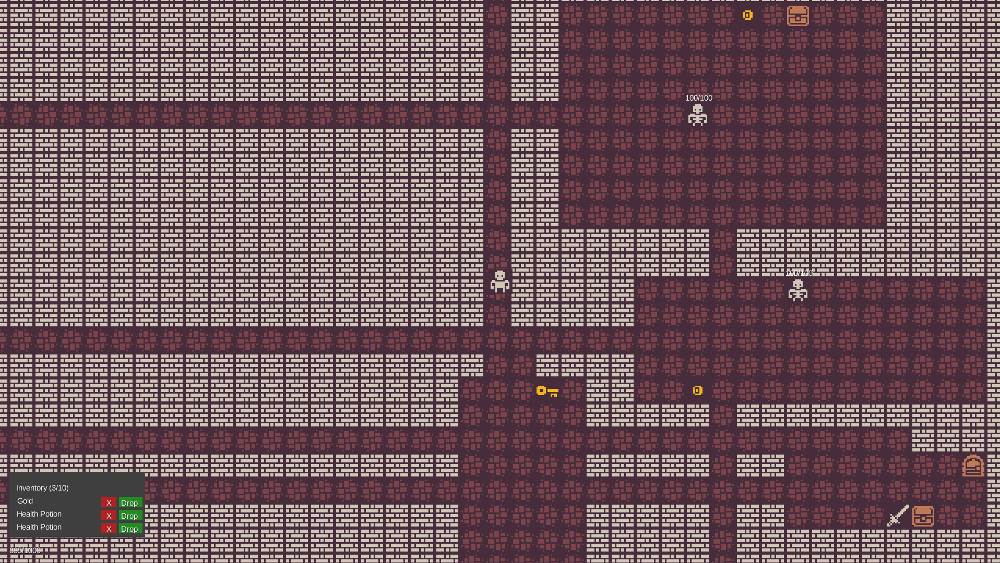

<p align="center">
  
</p>

# 🗡️ Roguelike Dungeon

A 2D roguelike dungeon crawler built with Java and LibGDX. This project is a long-term personal development project focused on game programming, object-oriented design, and building a complete, playable game step by step.

Explore procedurally generated dungeons, fight enemies, collect items, manage your inventory, and unlock exits to progress through new levels.

## 🛠️ Tech Stack

<p align="left">
  
  
  
  
  
  
</p>

## ✨ Features

- **Procedural dungeon generation** – Explore newly generated dungeon layouts as you progress.
- **Dungeon exits and level transitions** – Find locked exits, use keys, and move between levels with smooth fade-out and fade-in animations.
- **Combat system** – Fight enemies using the current attack mechanics.
- **Inventory management** – Collect, drop, and manage items.
- **World items** – Discover keys and other items throughout the dungeon.
- **Enemy spawning** – Enemies are generated as part of each dungeon level.
- **Collision detection** – Movement is restricted by walls and other non-walkable tiles.
- **In-game notifications** – Receive feedback when interacting with dungeon exits.

## 🎮 Controls

| Key | Action |
|---|---|
| `W` `A` `S` `D` | Move |
| `Arrow Keys` | Move |
| `SPACE` | Attack |
| `E` | Interact with doors or pick up items |
| `I` | Open or close inventory |

## 🚀 Getting Started

Follow these steps to run the game locally.

### Prerequisites

Install the following software before proceeding:

| Requirement | Version | Purpose |
|---|---|---|
| Java Development Kit (JDK) | **21** | Compiling and running the game |
| Git | Latest stable version | Cloning the repository |

You do not need to install Gradle separately. The project includes the Gradle Wrapper, which downloads and uses the configured Gradle version automatically.

**Important:** Use JDK 21, not just a Java Runtime Environment (JRE). A JDK is required to compile the source code.

### 1. Verify your Java installation

Open a terminal and run:

```bash
java -version
```

The output should identify Java 21.

Check that the Java compiler is available as well:

```bash
javac -version
```

If either command is missing or reports a different major version, install JDK 21 and configure your `JAVA_HOME` environment variable if necessary.

### 2. Clone the repository

```bash
git clone <YOUR_REPOSITORY_URL>
cd roguelike-dungeon
```

Replace `<YOUR_REPOSITORY_URL>` with the HTTPS or SSH URL of this repository.

### 3. Navigate to the game project

The LibGDX application is located in the `game/` directory:

```bash
cd game
```

Run the following commands from this directory, where the Gradle Wrapper scripts are located.

### 4. Run the desktop application

**Windows (PowerShell or Command Prompt):**

```powershell
.\gradlew.bat lwjgl3:run
```

**Linux / macOS:**

```bash
./gradlew lwjgl3:run
```

On Linux or macOS, if the wrapper script is not executable, run:

```bash
chmod +x gradlew
./gradlew lwjgl3:run
```

The first run may take longer because Gradle needs to download the required dependencies. Once the build and launch tasks complete successfully, the game window should open.

### 5. Build the project without launching the game

To compile the project and run the configured build checks:

**Windows:**

```powershell
.\gradlew.bat build
```

**Linux / macOS:**

```bash
./gradlew build
```

## 📁 Project Structure

The repository separates the game code from the desktop launcher and build configuration.

```text
roguelike-dungeon/
├── README.md
└── game/
    ├── core/
    │   ├── src/
    │   │   └── main/
    │   │       └── java/
    │   │           └── com/marton/roguelike/
    │   │               ├── entity/       # Player and enemy entities
    │   │               ├── input/        # Player input and controls
    │   │               ├── item/         # Items and inventory
    │   │               ├── render/       # Rendering and UI
    │   │               ├── world/        # Map and dungeon generation
    │   │               └── Main.java     # Main game controller
    │   └── build.gradle
    ├── lwjgl3/                           # Desktop launcher and configuration
    │   └── build.gradle
    ├── assets/                            # Game assets
    ├── gradle/
    │   ├── wrapper/
    │   │   ├── gradle-wrapper.jar
    │   │   └── gradle-wrapper.properties
    │   └── gradle-daemon-jvm.properties
    ├── build.gradle
    ├── settings.gradle
    ├── gradle.properties
    ├── gradlew
    └── gradlew.bat
```

*Note: This is a high-level overview. Individual packages and files may evolve as development continues.*

### Architecture overview

- **Core module:** Contains the platform-independent game logic and rendering code.
- **LWJGL3 module:** Provides the desktop application entry point.
- **World generation:** Creates dungeon layouts, corridors, exits, and other world elements.
- **Rendering layer:** Draws the map, entities, items, UI, and screen transitions.

## 🧭 Development Status

The project is actively being developed. The current version focuses on establishing a functional dungeon gameplay loop and a maintainable foundation for future features.

Implemented and tested:

- Procedurally generated dungeon levels
- Player movement and collision detection
- Enemy spawning and combat
- Item pickup and dropping
- Inventory management
- Key-based dungeon exits
- Notifications and animated level transitions
- Preservation of player health and inventory between dungeon levels

Some gameplay behaviors, including the current game-over behavior, are intentionally basic and may change during future development.

## 🎯 Project Goals

The long-term goal is to develop a complete and enjoyable roguelike game while continuously improving the underlying codebase.

Planned areas of development include:

- Further dungeon generation improvements
- Expanded enemy and item systems
- Improved game progression and balancing
- Additional gameplay mechanics
- Automated testing and code quality improvements
- Improved documentation and presentation

## 📄 License

No license has been specified yet. Unless a license is added to the repository, the project should not be assumed to be available for unrestricted reuse or redistribution.